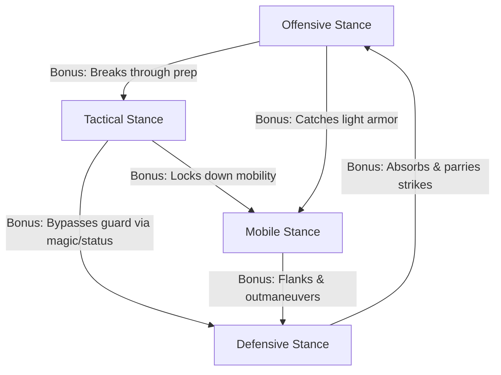
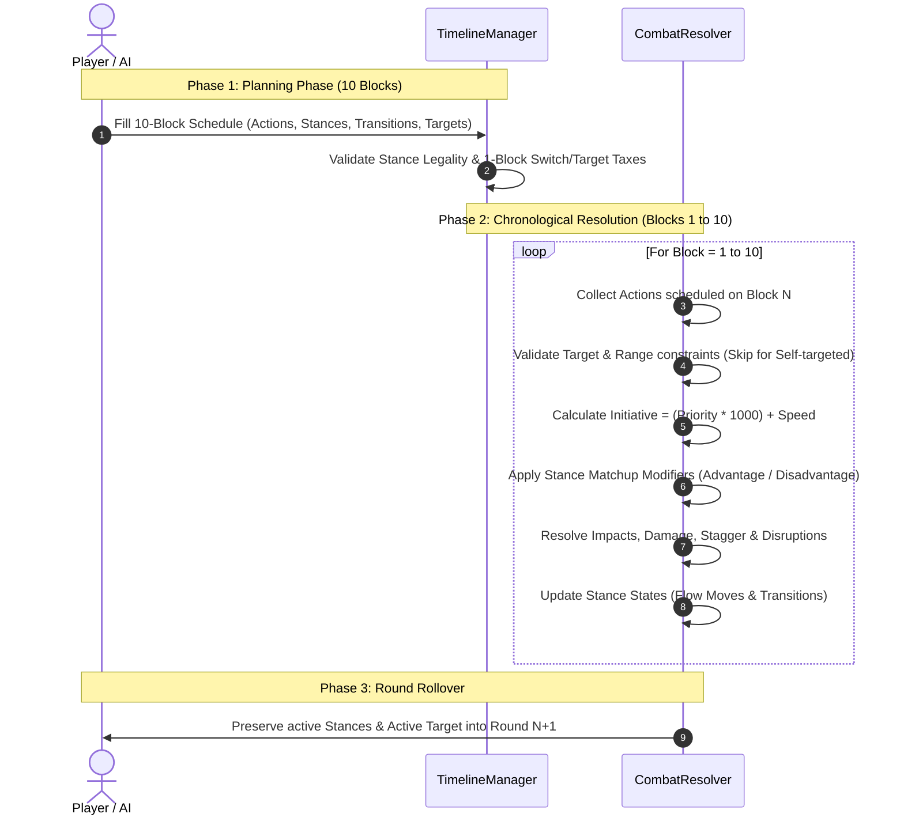

# Tactical Combat System Specification: 10-Block Timeline & Stance Matrix

## 1. Executive Summary

The combat system is a **deterministic, simultaneous-turn tactical RPG system** built around a **Fixed 10-Block Timeline**. Combatants plan actions into a 10-block round schedule, which resolves chronologically from Block 1 through Block 10. Actions transition characters into distinct **Stances** that dictate tactical matchups, action legality, and combo flow.

---

## 2. The 10-Block Action Economy

```
Round Timeline (10 Time Blocks):
[ 1 ][ 2 ][ 3 ][ 4 ][ 5 ][ 6 ][ 7 ][ 8 ][ 9 ][ 10 ]
|-- Target (1b) --|--- Thrust (2b) ---| ToNeutral (1b) |-- Shield Wall (3b) --| [Idle 3b]
```

- **Round Budget:** Every combatant has a fixed budget of **10 blocks** per round.
- **Action Duration:** Actions cost between **1 and 3 blocks**:
  - **Quick / Transition (1 block):** Quick strikes, micro-steps, entering neutral stance, targeting / disengaging.
  - **Standard Action (2 blocks):** Regular attacks, shield blocks, single buffs/debuffs, standard moves.
  - **Heavy / Complex Action (3 blocks):** Heavy impacts, channeled spells, multi-target barriers.
- **Round Rollover (State Persistence):** 
  - Stance, active target lock, and active buffs/debuffs **persist into subsequent rounds** as long as combat is active. Characters start Round $N+1$ on Block 1 in whichever stance they ended Round $N$.
- **Unassigned Blocks:** Any unallocated blocks in the 10-block window become **Idle / Guard recovery**, conferring a minor evasion/recovery bonus.

---

## 3. The 5 Core Action Archetypes

| Action Type | Primary Function | Typical Cost | Natural Stance Result | Typical Range |
| :--- | :--- | :---: | :---: | :---: |
| **Attack** | Primary damage output (physical or elemental). | 1 – 3 Blocks | **Offensive Stance** | Melee / Ranged (Requires Target) |
| **Defend** | Damage mitigation, parrying, shielding, or health restoration. | 1 – 3 Blocks | **Defensive Stance** | Self (No Target req.) / Ally |
| **Skill** | Buffs for allies, debuffs, status effects, and battlefield control. | 2 – 3 Blocks | **Tactical Stance** | Self / Ranged / Area (Target/Location) |
| **Item** | Direct inventory use (potions, scrolls, throwables, gadgets). | 1 – 2 Blocks | **Utility Stance** | Self (No Target req.) / Target |
| **Move** | Positioning, battlefield traversal, flanking, and spacing. | 1 – 2 Blocks | **Mobile Stance** | Movement Grid |

> [!TIP]
> **Targeting (1 Block, Neutral Stance):** In addition to the 5 core action archetypes, **Target** is a universal 1-block transition action performed in Neutral Stance to engage a combatant/location or disengage (by clearing target). Self-targeted skills and guard actions never require an active target.

---

## 4. Stances, Neutrality & Stance Transitions

### 4.1 The 6 Combat Stances

1. **Neutral Stance (The Universal Pivot):** 
   - Baseline, uncommitted posture with no offensive or defensive stance matchup penalties.
   - **Cost to Enter Only:** Entering Neutral Stance from any active stance costs **1 Block**.
   - **Zero Cost to Exit:** Once in Neutral Stance, **all combat options are unlocked and available starting the very next block**. There is **no cost (0 blocks)** to switch from Neutral Stance into any other stance—initiating any valid action simply incurs that action's standard cost and naturally establishes the action's resulting stance upon execution.
   - Dropping into Neutral Stance offers maximum tactical flexibility: it sheds active disadvantage penalties, clears stance locks, and enables unconstrained action choices or the 1-block **`Target`** action.
2. **Offensive Stance:** Aggressive, forward-leaning posture. High damage and pressure; vulnerable to defensive counters.
3. **Defensive Stance:** Guarded posture behind shields or weapons. High mitigation and sustain; low mobility and offensive output.
4. **Tactical Stance:** Focused mental state for channeling abilities, incantations, and tactical calls. Vulnerable to fast offensive rushes.
5. **Utility Stance:** Tool and item preparation posture. Highly adaptable; low direct combat defense.
6. **Mobile Stance:** Agile, light-footed posture for rapid traversal, flanking, and skirmishing.

---

### 4.2 Stance Transition Rules & The Neutral Reset

- Actions inherently leave the user in their **associated stance** upon resolution.
- **The Neutral Transition Loop:**
  - To transition from an active stance (e.g., Defensive) to an action restricted by that stance (e.g., an Attack):
    1. **Block $N$:** Spend **1 Block** performing **`Enter Neutral Stance`**.
    2. **Block $N+1$:** Freely execute any desired action (e.g., *Slash*, 2b). The action incurs only its own normal block cost and naturally deposits the character into its resulting stance (**Offensive Stance**) upon execution.
  - **Single Cost Principle:** The 1-block transition cost is paid **solely to enter Neutral Stance**. Exiting Neutral Stance has zero additional overhead.

### 4.3 Flow Moves (Natural Stance Chaining)

Certain specialized skills and attacks are designed as **Flow Moves**:
- **Definition:** An action that naturally resolves into a *different* stance than its primary category.
- **Benefit:** Allows players to chain combos across stance boundaries without spending the 1-block `Switch Stance` tax.
- *Example:* `Vaulting Strike` (Attack, 2b) deals damage and automatically deposits the character into **Mobile Stance** at completion, allowing an immediate `Sprint` without switching.

### 4.4 Hold Stance (1 Block, Stance Maintenance)

Every stance features a dedicated **`Hold Stance`** action:
- **Duration:** 1 Block.
- **Effect:** Keeps the character in their current active stance without executing a new attack, move, or spell.
- **Benefits:**
  1. **Retains Stance Bonuses:** Extends the stance's active matchup advantages and damage reductions across that block.
  2. **Scales Duration-Based Skills:** Increments the character's internal `stance_hold_duration` counter. Certain abilities deal scaled damage, provide higher shield barriers, or expand range based on how many consecutive blocks the stance was maintained.
  3. **Timeline Pacing & Delay:** Fills idle blocks intentionally to wait out an enemy's defensive barrier, align with an ally's combo window, or delay an attack until an opponent's guard drops.

---

## 5. Stance Matchup Affinity (The Tactical Advantage Matrix)

When two combatants clash during the same time block, their active stances interact with advantage and disadvantage modifiers:



### Matchup Resolution Modifiers

| Attacker Stance | Target: Offensive | Target: Defensive | Target: Tactical | Target: Mobile | Target: Utility |
| :--- | :---: | :---: | :---: | :---: | :---: |
| **Offensive** | Neutral (1.0x) | **Disadvantage (0.75x)** *(Parried / Blocked)* | **Advantage (1.25x)** *(Interrupted / Punished)* | **Advantage (1.15x)** *(High Pressure)* | **Advantage (1.25x)** *(Overwhelmed)* |
| **Defensive** | **Advantage (Counter/Mitigate)** | Neutral | **Disadvantage** *(Status/Magic bypasses)* | Neutral | Neutral |
| **Tactical** | **Disadvantage** *(Rushed down)* | **Advantage (1.25x)** *(Unblockable Debuff)* | Neutral | **Advantage (Pin Down)** | Neutral |
| **Mobile** | **Disadvantage** | **Advantage (Flank/Bypass)** | Neutral | Neutral | **Advantage (Raid)** |

---

## 6. Stance Disruption & Stagger

- **Disruption Property:** Specific heavy attacks or tactical skills possess the `disruptive` tag (e.g., *Shield Bash*, *Concussive Blast*, *Sundering Strike*).
- **Stagger Effect:** When a disruptive action successfully lands against a target:
  1. It **breaks** the target's current stance, forcing them into **Neutral Stance** or a **Staggered** state.
  2. The target incurs a **1-block delay** or loses their scheduled stance bonus for the remainder of that block.
  3. Any channeled action (e.g., 3-block Tactical spell in progress) is **interrupted**.

---

## 7. Targeting & Engagement Mechanics

Rather than managing separate engage and disengage modes, targeting, positioning focus, and engagement are handled via a unified **Target** action:

```
[ Combatant Focus ]  <--->  [ Grid Location (Vector2i) ]  <--->  [ Clear Focus: null ]
     (Engaged)                     (Ranged / AOE Area)                  (Disengaged)
```

### 7.1 The Unified Target Action Rules

1. **Targeting as a Neutral Stance Action:**
   - Setting, switching, or clearing an active target requires **1 Block executed in Neutral Stance** (or transitioning through Neutral Stance).
2. **Valid Target Types:**
   - **Combatant:** Locks focus onto a specific ally or opponent within range (melee contact or ranged skill reach), establishing engagement.
   - **Location (`Vector2i`):** Designates ground/cell coordinates for ranged or area-of-effect skills within range.
3. **Disengaging (`target = null`):**
   - Disengaging from a locked combatant or clearing active focus is performed simply by executing the Target action with `null`.
   - Clearing target status unlocks free movement, removes melee engagement pressure, and resets threat tracking.
4. **Self-Target Exception:**
   - Actions targeting `self` (such as self-healing, shield guard, stat buffs, or personal item use) **can always be used without requiring an active target**, regardless of whether the character has a target selected.

---

## 8. Round Lifecycle & Resolution Workflow



---

## 9. Technical Architecture & Data Model (GDScript)

### 9.1 Enums & Types
```gdscript
enum ActionType {
	ATTACK,
	DEFEND,
	SKILL,
	ITEM,
	MOVE,
	ENTER_NEUTRAL,
	HOLD_STANCE,
	TARGET
}

enum StanceType {
	NEUTRAL,
	OFFENSIVE,
	DEFENSIVE,
	TACTICAL,
	UTILITY,
	MOBILE,
	STAGGERED
}
```

### 9.2 Core Class Extensions
- **`Combatant` (`scripts/combat/combatant.gd`):**
  - `var current_stance: StanceType = StanceType.NEUTRAL`
  - `var stance_hold_duration: int = 0` *(Tracks consecutive blocks current stance has been maintained)*
  - `var active_target: Variant = null` *(Holds a Combatant, Vector2i grid coordinate, or null)*
  - `var attack_boost_multiplier: float = 1.0`
  - `var attack_boost_rounds_remaining: int = 0` *(2 rounds for Focus: active round + subsequent round)*
  - `var defense_mitigation_ratio: float = 0.0` *(Temporary defense mitigation during active Defend block)*
  - `var timeline: Array[BattleCommand] = []` *(Length 10)*
  - `func set_target(new_target: Variant) -> void`
  - `func clear_target() -> void` *(Disengages by setting active_target to null)*
  - `func has_target() -> bool`
  - `func apply_attack_boost(multiplier: float, duration_rounds: int) -> void`
  - `func tick_round_buffs() -> void` *(Decrements buff timers at round end)*
- **`BattleCommand` (`scripts/combat/battle_command.gd`):**
  - `var block_cost: int = 1` *(1 to 3 blocks)*
  - `var required_stance: StanceType = StanceType.NEUTRAL` *(Stance requirement; if NEUTRAL, can be initiated from Neutral or compatible stances)*
  - `var resulting_stance: StanceType = StanceType.NEUTRAL` *(Automatically establishes new stance upon action execution)*
  - `var is_disruptive: bool = false`
  - `var is_self_targeted: bool = false` *(If true, does not require an active target)*
- **`FocusCommand` (`scripts/combat/focus_command.gd`):**
  - Inherits `BattleCommand`
  - `block_cost = 2`
  - `action_type = ActionType.SKILL`
  - `resulting_stance = StanceType.TACTICAL`
  - `is_self_targeted = true`
  - Applies `source.apply_attack_boost(1.5, 2)` (boost active for 2 full rounds)
- **`DefendCommand` (`scripts/combat/defend_command.gd`):**
  - Inherits `BattleCommand`
  - `block_cost = 2`
  - `priority = 1`
  - `action_type = ActionType.DEFEND`
  - `resulting_stance = StanceType.DEFENSIVE`
  - `is_self_targeted = true`
  - Applies `defense_mitigation_ratio = 0.5`
- **`EnterNeutralCommand` (`scripts/combat/enter_neutral_command.gd`):**
  - Inherits `BattleCommand`
  - `block_cost = 1`
  - Sets `source.current_stance = StanceType.NEUTRAL` (unlocks all action pools starting next block with 0 exit fee)
- **`HoldStanceCommand` (`scripts/combat/hold_stance_command.gd`):**
  - Inherits `BattleCommand`
  - `block_cost = 1`
  - Increments `source.stance_hold_duration` and retains stance matchup bonuses
- **`TargetCommand` (`scripts/combat/target_command.gd`):**
  - Inherits `BattleCommand`
  - `block_cost = 1`
  - `required_stance = StanceType.NEUTRAL`
  - Sets `source.active_target = target` (or `null` to disengage)
- **`TimelineResolver` (`scripts/combat/timeline_resolver.gd`):**
  - Iterates blocks $1 \to 10$.
  - Applies stance matchup multipliers (1.25x / 0.75x).
  - Handles target validation, disruption, and interrupts.


