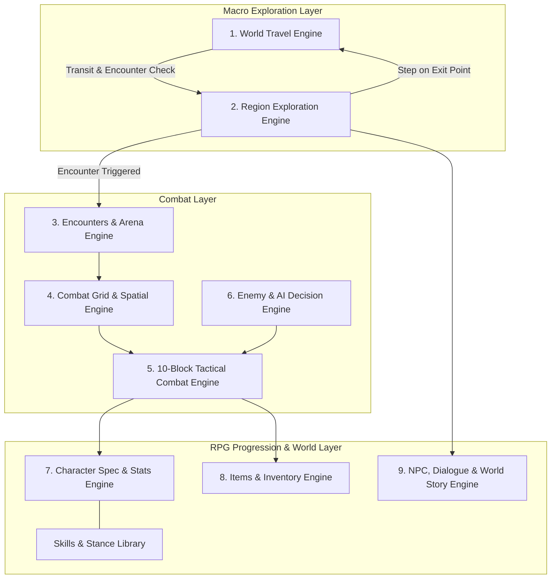

# Modular Tactical RPG - Comprehensive Game Design & Architecture Specification

## 1. Core Vision & Modular Rules-Engine Philosophy

This game is designed as a **Modular Tactical RPG** where every major domain is governed by an **independent, composable Rules Engine**. 
Instead of a monolithic game manager, each system operates on a clean, decoupled **Pipeline / Rules Evaluation Model**:

```
[Domain Context] ---> [Rule 1: Base] ---> [Rule 2: Modifier] ---> [Rule 3: Condition] ---> [Resolved Output]
```

- **Incremental Complexity:** Each engine launches with **Phase 1 (Simple Baseline Rules)** to achieve a stable, playable game loop quickly.
- **Additive Expansion:** New features (weather hazards, status conditions, class synergies, travel curses) are introduced as **additive rule components** without modifying the engine core.
- **Strict Decoupling:** All simulation rules inherit from `RefCounted`, allowing 100% headless automated testing via `godot --headless`.

---

## 2. Master System Blueprint (The 9 Modular Engines)



---

## 3. System Specifications

### System 1: World Map & Travel Engine
- **Macro Topology:** A connected node/region graph of key geographical regions (plains, mountains, forests, ruins, settlements).
- **Travel Mechanism:**
  - Selecting a connected destination initiates travel across the world route.
  - **Travel Time Rule:** Travel consumes in-game time units/hours based on distance and route terrain difficulty.
  - **Travel Encounter Rule:** Each travel leg rolls for random encounters based on the route's danger rating. If triggered, transitions to the Combat Layer using the route's environmental biome.
- **Phase 1 Baseline Rules:**
  - Simple point-to-point adjacency list.
  - Flat travel time (e.g., 3 time units per route).
  - Fixed % roll per travel leg for encounter.
- **Future Additive Rules:** Route weather conditions, road hazards, travel supply/food consumption, merchant caravans.
### System 2: Region Map & Exploration Engine
- **Local Topology:** A 2D top-down grid representing a specific visited region.
- **Zone Taxonomy:**
  - **Safe Zones:** Towns, settlements, sanctuaries. Zero encounter rolls; enables party resting, trading, and dialogue.
    - Features fixed/positioned special encounters and quest dialogues.
    - Populated with generic "mob NPCs" providing ambient interaction and rumors.
  - **Danger Zones:** Wilderness, dungeons, ruins.
    - **Step-Based Mob Encounters:** Standard roaming mobs trigger via step accumulation with a dice roll for rare mob encounters.
    - **Visible Roaming Encounters:** Special, elite, or boss encounters appear as visible, positioned/moving entities on the 2D grid that initiate combat upon proximity or touch.
- **Exit Points:**
  - Designated edge or portal tiles on the region map.
  - Stepping onto an Exit Point tile opens the World Map for travel to nearby connected regions.
- **Phase 1 Baseline Rules:**
  - Discrete grid step movement (`Vector2i` coordinates).
  - Tile-based zone classification (`SAFE` vs `DANGER`).
  - Danger step counter: after accumulating danger steps, a mob encounter initiates.
  - Stepping on an exit tile prompts region departure to World Map.
- **Future Additive Rules:** Interactive terrain obstacles (bridges, locked gates, puzzle switches), interactive loot chests, stealth / detection cones for roaming mobs.

---

### System 3: Combat Grid & Spatial Positioning Engine
- **Arena Geometry:**
  - **Fixed 9x9 Grid (0 to 8 on both axes):** Center tile is exactly `Vector2i(4, 4)`.
  - **Region Attributes:** Arena terrain type, environmental hazards, and visual backdrop are inherited directly from the region where the encounter was triggered.
- **Arena Boundary Types:**
  - **Open Combat Grid (Wilderness, Open Plains):** All perimeter boundary tiles (`x == 0`, `x == 8`, `y == 0`, `y == 8`) are valid escape edges.
  - **Closed Combat Grid (Caves, Dungeons, Walled Arenas, Ambushes):** Escape is restricted to **limited, designated exit tiles** (e.g. specific gate/door coordinates). Units must maneuver tactically across the grid to reach an exit point to retreat.
- **Deployment & Starting Placement Rule:**
  - Combatants spawn in a ring near the **center of the map `(4, 4)`**.
  - **Ranged-capability offset:** Spawn distance from center is adjusted based on each combatant's attack range (e.g. melee at distance 1, ranged at distance 2–3), ensuring **every combatant can target the center of the grid from their starting tile on Block 1**.
- **Movement Integration & Action Economy:**
  - Movement is scheduled as `MoveCommand` on the 10-block timeline.
  - **Move (1 Block):** Move 1 tile in cardinal directions (Up, Down, Left, Right).
  - **Sprint / Dash (2 Blocks):** Move 2 tiles.
  - **Natural Stance Result:** `Mobile Stance`.
- **Perimeter Escape & Partial Withdrawal Rule:**
  - Any combatant who moves onto a valid exit tile (or outer perimeter on Open arenas) triggers **Withdrawal**.
  - **Partial Withdrawal:** Individual party members or enemies can escape independently without ending the fight for the rest.
  - Withdrawn combatants are removed from the active arena timeline without counting as casualties/defeats.
- **Combat Termination Rule:**
  - Combat officially terminates when **no hostile units remain on the combat grid** (all enemies are either defeated or have withdrawn, or all player units have withdrawn/fallen).
- **Phase 1 Baseline Rules:**
  - $9 \times 9$ grid with center `(4, 4)`.
  - Radial center-ring deployment with range offsets.
  - 1 Move block = 1 orthogonal tile step.
  - Stepping on exit = unit withdrawn from active roster.
- **Future Additive Rules:** Line-of-sight & half/full cover obstacles, knockback/forced repositioning from disruptive skills, hazardous elemental tiles (fire, poison, ice).
---

### System 4: 10-Block Tactical Combat & Stance Engine
*(Detailed in `.context/COMBAT_SYSTEM.md`)*
- Fixed 10-block action timeline resolved simultaneously.
- 6 active combat stances (`Neutral`, `Offensive`, `Defensive`, `Tactical`, `Utility`, `Mobile`) plus `Staggered`.
- Action archetypes: Attack, Defend, Skill, Item, Move, Enter Neutral, Hold Stance, Target.
- Deterministic initiative ordering: `(priority * 1000) + speed`.

---

### System 5: Character Spec & Stats Engine
- **Core Attributes:** Max HP, Speed, Physical Power, Magic/Tactical Power, Defense, Range.
- **Phase 1 Baseline Rules:**
  - Base stat definitions with flat level scaling.
  - Stance compatibility flags.
- **Future Additive Rules:** Passive trait slots, equipment stat modifiers, class archetypes, attribute affinities.

---

### System 6: Skills & Combo Engine
- **Skill Definitions:** Actions that consume 1–3 timeline blocks, require specific stances or target locks, and apply damage, buffs, or debuffs.
- **Phase 1 Baseline Rules:**
  - Attack, Defend, Focus buff, Target lock, Hold Stance.
- **Future Additive Rules:** Chained Flow Moves (exiting naturally into another stance), AoE shapes on the combat grid, Stance Disruption / Stagger.

---

### System 7: Items & Inventory Engine
- **Inventory Model:** Shared party bag with consumable items and equippable gear.
- **Phase 1 Baseline Rules:**
  - Consumables used via `ItemCommand` (1–2 blocks, Utility Stance).
  - Healing potions (flat HP restore) and basic throwables.
- **Future Additive Rules:** Equipment slots influencing block speed and unlocked commands, durability, inventory weight.

---

### System 8: Enemies & AI Decision Engine
- **Tactical Intent Planning:** At the start of each 10-block round, AI evaluates the combat state and schedules actions.
- **Phase 1 Baseline Rules:**
  - Deterministic heuristics:
    - If HP $< 25\%$ and near grid edge $\to$ prioritize `MoveCommand` toward boundary (Attempt Withdrawal).
    - If engaged $\to$ alternate Defend and Attack based on target stance.
- **Future Additive Rules:** Role archetypes (Aggressor, Sniper, Support, Coward), threat weighting, flank movement positioning.

---

### System 9: NPC, Dialogue & World Story Engine
- **World State Model:** Key/value flag registry (`Dictionary[String, Variant]`).
- **Phase 1 Baseline Rules:**
  - Static NPC interaction prompts with branching choices.
  - Quest flags unlocking region exit points or triggering story events.
- **Future Additive Rules:** Faction reputation meters, bartering shop systems, timed world events.

---

## 4. Phase 1 Implementation Roadmap

```
Milestone 1: Combat Grid & Spatial Engine (In-progress)
  ├── 1.1 2D Grid Data Model (Size, Center, Perimeter)
  ├── 1.2 Center-ring Deployment with Range Offsets
  ├── 1.3 MoveCommand & Grid Coordinate Validation
  └── 1.4 Perimeter Boundary Escape / Partial Withdrawal Verification

Milestone 2: Region Map & Exploration (2D Grid)
  ├── 2.1 Region Grid & Tile Types (Safe vs Danger)
  ├── 2.2 Danger Step Encounter Trigger
  └── 2.3 Region Exit Points & Transition Hooks

Milestone 3: World Map & Travel Engine
  ├── 3.1 Region Node Graph
  ├── 3.2 Travel Duration & Road Encounter Roll
  └── 3.3 Seamless Transition (World Map <-> Region Map <-> Combat Grid)

Milestone 4: AI Intent & Withdrawal Logic
  └── 4.1 Automated AI Action Planning & Flee Thresholds
```
